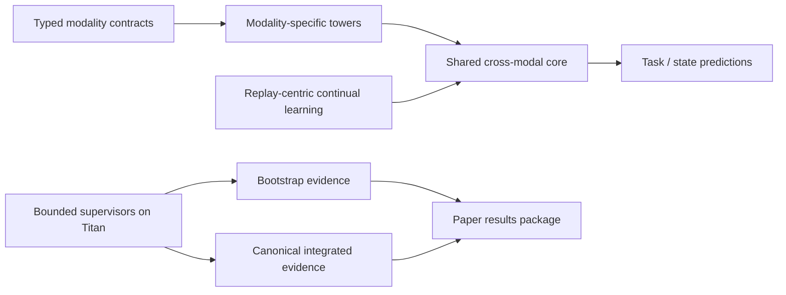

# Sensory Perceiver

Sensory Perceiver is a research codebase for machine perception under continual adaptation. The repository combines:
- modality-specific towers,
- shared cross-modal attention,
- replay-aware continual-learning workflows,
- typed runtime contracts and service-layer entrypoints,
- Titan-oriented experiment automation and paper packaging.

## What This Project Is

Sensory Perceiver is a research system for machine perception. It is designed around the idea that a perceptual model should:

- accept heterogeneous sensory streams as explicitly typed inputs,
- preserve modality identity through modality-specific towers,
- integrate those streams through a shared perceptual core,
- and continue adapting over time without catastrophic forgetting.

In this repository, that broader idea appears in two coupled layers:

1. **Perception architecture**
   - modality-specific towers plus shared cross-modal attention in [core.py](/Users/zachshallbetter/Projects/Perception/src/models/core.py)
   - canonical MIME-style modality registry for `sensor_streaming` in [mime_cases.py](/Users/zachshallbetter/Projects/Perception/src/runtime/mime_cases.py)
   - sensor-streaming modality definitions for `smartwatch`, `room_env`, and `robot_arm`

2. **Continual-learning evidence path**
   - replay-centric continual-learning benchmarks on Split-CIFAR-100
   - task-adapter isolation primitives and opt-in sequential rollover
   - paper-primary empirical results currently centered on replay-path design and retention

The important distinction is:

- **Conceptually**, this project is about multimodal perception with explicit modality semantics and temporal adaptation.
- **Empirically**, the strongest current validated evidence is still continual-learning behavior, especially how replay placement affects forgetting.

So this is not just a CIFAR experiment repo, and it is not yet a finished large-scale multimodal foundation model. It is a perception research platform whose current best-proven result is replay-centric continual learning.

## What This Project Is Not

To keep the claims honest:

- it is not yet a comprehensively validated large-scale multimodal perception benchmark suite
- it is not yet a paper where the broadest sensor/MIME claims have more evidence than the continual-learning core
- it is not a claim that MIME strings are parsed directly inside model `forward()`

The strongest current evidence is still replay-centric continual learning. The next most important evidence path is the sensor/MIME canonical-vs-merged ablation now exposed through `scripts/launch_sensor_mime_ablation_titan.sh`, which uses a harder synthetic sensor task with compositional class codes, shared nuisance structure, and a shifted validation regime instead of random labels. The follow-on sequence is also wired: leave-one-out, MIME-binding corruption, single-modality noise robustness, and capacity-matched controls, with a bounded Titan-local supervisor to drive the sequence autonomously.
Real-data scaffolding now plugs into the same experiment families through prepared canonical manifests under `data/real-sensor/` and `data/real-audio/`. Current real-data status is explicit:
- integrated real sensor datasets:
  - `wisdm`
  - `pamap2`
  - `opportunity`
  - `uci_har`
  - `hhar`
  - `mhealth`
  - `selfback`
  - `geomagnetic_wlan`
- integrated real audio datasets:
  - `speech_commands`
  - `esc50`
  - `urbansound8k`
  - `fsd50k`
- integrated HF-backed follow-ons:
  - `realworld_har`

Deferred legacy sources remain out of the bounded chain:
- `audioset`, because only metadata CSVs are available and the active replacement is `fsd50k`
- `ubiqlog`, because the active HF replacement is `realworld_har`

The real-data path is also prepared for bounded autonomous progression on Titan through `scripts/run_real_sensor_sequence_autonomous.sh`, which only launches datasets that are actually prepared and reports blocked/candidate datasets explicitly. See `docs/real-sensor-datasets.md`.
The same bounded pattern now exists for audio through `scripts/run_real_audio_sequence_autonomous.sh`, with `speech_commands`, `esc50`, `urbansound8k`, and `fsd50k` integrated into the `multimodal` experiment family.
For reporting and paper packaging, treat the real-data sequences in two tiers:
- bootstrap evidence:
  - `real-audio-seq-001` for first-pass `speech_commands`
  - `real-seq-004` for first-pass `wisdm`
- canonical integrated evidence:
  - `real-audio-seq-002` for `speech_commands`, `esc50`, `urbansound8k`, `fsd50k`
  - `real-sensor-seq-001` for the integrated real-sensor lineup including `realworld_har`
If you want one bounded sequence to hand off directly to the next without manual intervention, use the chain helpers:
- `scripts/chain_real_sensor_sequence.sh`
- `scripts/chain_real_audio_sequence.sh`
- `scripts/chain_audio_to_sensor_sequence.sh`

## Who This Is For

This project is most useful for three groups:

1. **Research engineers**
   - people studying continual learning, multimodal routing, replay design, or modular perception architectures
   - use the repository as a code-aligned experimental platform rather than a static reference implementation

2. **Applied ML engineers**
   - teams building systems around wearables, robotics, ambient sensing, or other heterogeneous sensor inputs
   - use the architecture and runtime-contract patterns to structure multimodal inputs explicitly and reduce silent interface drift

3. **Platform and product teams**
   - organizations that need models to keep adapting without full retraining every time new data or new modalities appear
   - use the findings as design guidance:
     - keep modality identity explicit
     - validate modality semantics at the boundary
     - make replay act on the shared perceptual backbone, not only the classifier head

If you want a general-purpose finished product, this repository is too research-heavy. If you want a disciplined basis for building or evaluating a perception system that learns over time, it is directly useful.

## How To Use The Results

If the current claims continue to hold, the practical use of this repository is not "deploy Sensory Perceiver unchanged." The practical use is to adopt the design rules that the experiments are currently supporting:

1. **Use explicit modality structure**
   - keep `smartwatch`, `room_env`, `robot_arm`, or domain-equivalent modalities separate at the system boundary
   - avoid flattening heterogeneous sensors into one generic stream until there is evidence that doing so is harmless

2. **Use canonical runtime contracts**
   - drive modality setup from a single registry
   - validate modality identity at the boundary instead of letting implicit assumptions leak into training and inference

3. **Use replay as an update discipline**
   - when the model must keep learning, make replay act on the shared perceptual backbone
   - do not treat replay as a late-head patch if retention matters

4. **Treat this repository as a design reference**
   - use the code and paper as a blueprint for a domain-specific perception system
   - then replace synthetic `sensor_streaming` with real domain data and re-run the same evidence ladder

The strongest present user-facing takeaway is therefore architectural and operational: how to structure a perception system so it can ingest typed sensory inputs and adapt over time without immediately collapsing old competence.

## What Users Actually Get

If the current evidence continues to hold, the user-facing result is not "a paper benchmark" or "better MIME strings." The user-facing result is a perception system that can:

- combine multiple live signals instead of relying on one brittle input,
- keep modality structure explicit instead of flattening everything into one generic blob,
- adapt to new users, rooms, devices, or tasks over time,
- and keep doing that without immediately forgetting prior competence.

In practical terms, that means a future user could get:

1. **Better environment awareness**
   - systems that combine audio, movement, body state, and room context to infer what is happening instead of guessing from one sensor alone

2. **More robust assistive or health monitoring**
   - activity tracking, fall detection, rehab progression, and routine-change alerts that are less fragile when one modality is noisy or missing

3. **Richer human-computer interaction**
   - interfaces that respond to speech, pose, gesture, attention, or environmental cues together rather than as isolated channels

4. **More adaptive embodied systems**
   - robots or ambient agents that can update to new environments without full retraining and without erasing prior competence

The mechanisms in this repository exist to support that user outcome:

- typed modality contracts keep input identity explicit,
- modality-specific towers preserve local structure,
- shared integration lets the model combine signals coherently,
- replay-centric continual learning helps the system keep adapting over time.

The current repository should still be read as a design reference and research platform, not a drop-in finished product. But the intended user result is clear: a system that can perceive the world through multiple channels and keep improving without constantly starting over.

## Example User Stories

- A home monitoring user wants a system that can distinguish normal movement, distress, and inactivity by combining room audio, pose, and wearable signals.
- A rehab or sports user wants long-term movement tracking that learns their evolving baseline without forgetting earlier sessions.
- A robotics user wants a system that can fuse audio, vision, and body-state cues, then adapt to a new room or operator without retraining from scratch.
- A platform team wants to add a new modality cleanly and predictably, without rewriting the whole model or silently breaking data assumptions.

## Repository Layout

- `src/models/` — canonical model package (`core.py` + exports)
- `src/train.py` — training CLI entrypoint
- `src/eval.py` — evaluation CLI entrypoint
- `src/experiments/experiment_orchestrator.py` — multi-run orchestration CLI
- `src/services/` — training, evaluation, orchestration service layer
- `src/runtime/` — runtime config, validation, typed errors
- `src/observability/` — structured events + metrics collection
- `scripts/` — utility scripts for setup, orchestration, result processing
- `docs/` — operator guides, benchmark plans, and review/rebuttal notes
- `paper/sections/` — canonical paper source of truth
- `paper/figures/generated/results_package/` — current paper-ready tables/figures package

## Canonical Reading Order

If you are orienting yourself to the project, read in this order:

1. [README.md](/Users/zachshallbetter/Projects/Perception/README.md) for project scope and operating model.
2. [docs/README.md](/Users/zachshallbetter/Projects/Perception/docs/README.md) for the documentation map.
3. [docs/productization-roadmap.md](/Users/zachshallbetter/Projects/Perception/docs/productization-roadmap.md) for the path from research result to usable system.
4. [docs/live-deployment-architecture.md](/Users/zachshallbetter/Projects/Perception/docs/live-deployment-architecture.md) for the concrete live-system interpretation of the current architecture.
5. [docs/training-guide.md](/Users/zachshallbetter/Projects/Perception/docs/training-guide.md) for the canonical Titan workflow.
6. [docs/sensor-mime-experiment-plan.md](/Users/zachshallbetter/Projects/Perception/docs/sensor-mime-experiment-plan.md) for the current perception-side evidence ladder.
7. [paper/sections/README.md](/Users/zachshallbetter/Projects/Perception/paper/sections/README.md), [paper/sections/06-results.md](/Users/zachshallbetter/Projects/Perception/paper/sections/06-results.md), and [paper/sections/07-discussion.md](/Users/zachshallbetter/Projects/Perception/paper/sections/07-discussion.md) for the current paper-aligned claim surface.

## Concept Map



## Quick Start

1. Install dependencies:
```bash
pip install -r requirements.txt
```

Baseline wrappers should stay on `transformers` 4.x, but that dependency should live in a separate baseline environment. The core training environment does not require `transformers`.

Canonical 3-GPU paper launch:
```bash
CORE_PYTHON=/ai/envs/perception/bin/python \
BASELINE_PYTHON=/ai/envs/torch-cu118-smoke/bin/python \
bash scripts/launch_paper_benchmarks_titan.sh
```

Set-and-forget multi-seed campaign:
```bash
CORE_PYTHON=/ai/envs/perception/bin/python \
BASELINE_PYTHON=/ai/envs/torch-cu118-smoke/bin/python \
CORE_SEEDS=42,43,44 \
BASELINE_SEEDS=42,43,44 \
bash scripts/launch_titan_continuous_campaign.sh
```

Exploratory distillation replay campaign:
```bash
PYTHON_BIN=/ai/envs/perception/bin/python \
bash scripts/launch_distill_bwt_campaign.sh
```

Canonical sensor/MIME baseline routing comparison:
```bash
PYTHON_BIN=/ai/envs/perception/bin/python \
bash scripts/launch_sensor_mime_ablation_titan.sh
```

Autonomous bounded sensor evidence ladder:
```bash
PYTHON_BIN=/ai/envs/perception/bin/python \
bash scripts/run_sensor_sequence_autonomous.sh <baseline-family-id>
```

Autonomous real-data routing sequence:
```bash
PYTHON_BIN=/ai/envs/perception/bin/python \
bash scripts/run_real_sensor_sequence_autonomous.sh <sequence-id>
```

Autonomous real-audio sequence:
```bash
PYTHON_BIN=/ai/envs/perception/bin/python \
bash scripts/run_real_audio_sequence_autonomous.sh <sequence-id>
```

Periodic campaign monitor:
```bash
bash scripts/monitor_titan_campaign.sh <campaign-id> 60 3
```

Canonical remote dashboard from your Mac:
```bash
bash scripts/titan_remote_dashboard.sh
```

Live watch mode:
```bash
bash scripts/titan_remote_dashboard.sh --watch 60
```

2. Run a short training job:
```bash
python -m src.train --experiment continual --dataset split_cifar --epochs 1 --output_dir results/smoke_train
```

3. Evaluate a checkpoint:
```bash
python -m src.eval --checkpoint results/smoke_train/best_model.pt --experiment continual --dataset split_cifar --output_file results/smoke_train/eval_results.json
```

4. Run orchestrator quick mode:
```bash
python -m src.experiments.experiment_orchestrator --mode quick --n-gpus 1
```

## Validation

Run runtime/service checks before longer jobs:
```bash
python3 -m unittest test_runtime_contracts.py test_service_layer_smoke.py
```

Run environment preflight checks:
```bash
python scripts/validate_setup.py --verbose
```

## Current Canonical Results

The current paper-primary continual result is the tuned-core Split-CIFAR-100 path on Titan Node:

- `scripts/run_local.py --tuned`
- 6-seed mean: `CIL 23.96%`
- 6-seed mean: `BWT -30.39%`
- Task 0 retention mean: `25.1%`

The current paper package is under:

- `paper/figures/generated/results_package/`
- `paper/sections/06-results.md`

The strongest validated conclusion remains replay-centric:

- feature-only replay fails badly,
- raw-input replay with reservoir sampling materially improves retention,
- the tuned-core replay path remains better than the current exploratory EWC/SI/distillation variants.

## Notes

- Use module entrypoints (`python -m src.*`) as the canonical execution path.
- The paper-primary continual benchmark path is `scripts/run_local.py --tuned` on Split-CIFAR-100 with 20 tasks.
- A genuinely different replay mechanism class is available via `scripts/run_local.py --replay_mode distill`, which replays raw samples through a frozen previous-task teacher and optimizes KL distillation rather than labels or feature contrast alone.
- The paper-primary baselines are `scripts/run_baselines_cl.py --model perceiver` and `--model perceiver_io`.
- Results are written under `results/` with per-run configs, metrics, checkpoints, and eval outputs.
- The canonical live status surface is `scripts/render_titan_dashboard.py`, typically via `scripts/titan_remote_dashboard.sh` from the Mac.
- Baseline workflows are documented in `docs/baselines.md` and scripts under `scripts/`.
- Sensor-streaming MIME input cases are defined in `docs/sensor-streaming-mime-cases.md` and `src/runtime/mime_cases.py`.
- Sensor/MIME follow-on experiments can now be driven by a bounded Titan-local supervisor rather than a manual queue, with results recorded under `results/sensor_sequence_summaries/`.
- Continual `src.train` jobs follow the dataset benchmark task count by default. Split-CIFAR-100 and Permuted MNIST therefore run 20 sequential tasks unless `--continual_task_count` is overridden.
- Use a separate environment for baselines and install [requirements-baselines.txt](/Users/zachshallbetter/Projects/Perception/requirements-baselines.txt) there.
