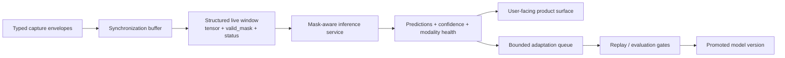
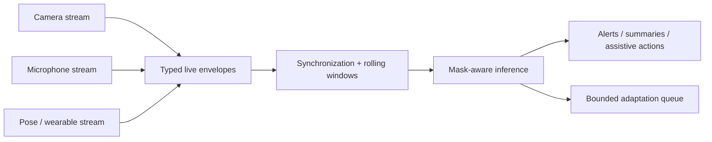

# Live Deployment Architecture

This document describes what Sensory Perceiver would need in a live environment, beyond offline training and evaluation.

Related files:
- [README.md](/Users/zachshallbetter/Projects/Perception/README.md)
- [productization-roadmap.md](/Users/zachshallbetter/Projects/Perception/docs/productization-roadmap.md)
- [live-system-contract.md](/Users/zachshallbetter/Projects/Perception/docs/live-system-contract.md)
- [core.py](/Users/zachshallbetter/Projects/Perception/src/models/core.py)
- [inference.py](/Users/zachshallbetter/Projects/Perception/src/services/inference.py)
- [live_schema.py](/Users/zachshallbetter/Projects/Perception/src/runtime/live_schema.py)

The goal is not "run the paper continuously." The goal is to turn the current architecture and evidence into a bounded, auditable perception service that can:

- ingest multiple live modalities,
- produce rolling interpretations of what is happening,
- tolerate missing or degraded sensors,
- and adapt over time without uncontrolled online learning.

## Live System Overview

## Live Example Flow

## What A Live User Actually Gets

If the architecture continues to validate, the user-facing result is a system that can:

- combine camera, audio, wearable, pose, depth, or room-sensor streams,
- infer what is happening in a room or around a person,
- remain useful when one modality is noisy or missing,
- and improve over time without repeated full retraining.

Example outcomes:

1. **Ambient or room awareness**
   - infer occupancy, movement, distress, unusual inactivity, or interaction patterns from multiple signals

2. **Assistive and health monitoring**
   - detect falls, movement changes, exercise quality, or routine drift using multiple channels together

3. **Multimodal interfaces**
   - combine speech, gesture, pose, and visual attention instead of treating them as isolated inputs

4. **Embodied or robotic perception**
   - fuse vision, sound, and body-state information while continuing to adapt to new environments or operators

## Required Live System Layers

### 1. Capture Layer

The live system needs canonical input envelopes for every modality it ingests. Examples:

- `vision.rgb.frame`
- `audio.mic.chunk`
- `pose.mediapipe.body`
- `depth.kinect.frame`
- `wearable.imu.window`
- `room.env.window`

Each live envelope should include:

- source id
- timestamp
- modality id
- sampling/window metadata
- health/quality metadata
- schema version

This preserves the same boundary discipline used by the prepared-data experiment contracts.

### 2. Stream Synchronization Layer

Live signals do not arrive perfectly aligned. The deployment path needs:

- timestamp normalization
- rolling window assembly
- bounded late-arrival handling
- missing-modality detection
- source heartbeat / health checks

Without this layer, a multimodal model is just consuming drift and pretending it is synchronized input.

### 3. Inference Layer

A live deployment needs a streaming inference service rather than only offline `train` and `eval`.

Responsibilities:

- build rolling multimodal windows
- route typed inputs into the correct modality towers
- produce predictions, confidence, and modality-health metadata
- smooth or debounce event outputs over time
- expose current state and recent evidence to downstream consumers

### 3.0 Tower Semantics Versus Tower Class

The live-system idea depends on **semantically distinct** modality towers, but that should not be confused with claiming that every modality already has a different neural block type in the current implementation.

Current implemented state:
- the repository uses one core `PerceiverTower` family
- modality differences are expressed through canonical routing, feature width, masking, and configuration

Live-system direction:
- a wearable or smartwatch stream may justify a stronger temporal bias
- an ambient room stream may justify a lighter contextual encoder
- a robot/device telemetry stream may justify a different structural bias for joint or actuator state

So the conceptual rule is:
- towers are distinct because the **meaning and structure** of their inputs differ
- specialization of the internal tower architecture is a deployment/design choice that can evolve over time

This distinction matters because the paper's current claim is about preserving modality semantics and learning cross-modal relationships, not about already shipping a different bespoke network class per modality.

The same distinction applies to the repository's current synthetic benchmark: `smartwatch`, `room_env`, and `robot_arm` are a concrete benchmark instance, not the universal modality set for a live Sensory Perceiver deployment.

### 3.1 Live Adapter Boundary

The repository now enforces a strict live input contract at the inference boundary:

- each modality is represented as a structured payload,
- each payload contains:
  - `tensor`
  - `valid_mask`
  - `status`

This is stricter than the older tensor-only model interface and is the correct long-term live contract.

The repository now supports both:

- native mask-aware models that consume the structured payload directly
- an explicit adapter boundary for older tensor-only models

To avoid pretending the old interface is already a native live API, the repository supports an explicit adapter boundary:

- live-capable models may declare `supports_live_valid_mask = True` and consume the structured payload directly
- legacy tensor-only models must be wrapped by `LiveTensorAdapter`

The adapter applies deterministic masking at the live boundary before handing tensors to the older model interface. Native mask-aware models go further by passing `valid_mask` into tower and integration logic directly. This keeps the deployment contract honest:

- the live service never silently drops `valid_mask`
- the model either consumes the structured payload itself
- or it is wrapped by an explicit compatibility layer

This is a deliberate staging strategy. It lets the live system become contract-clean before the entire core model stack is refactored around native mask-aware inputs.

### 4. Adaptation Layer

This is where the continual-learning result matters operationally.

A live system should not perform unconstrained online learning. It needs:

- a bounded replay store
- candidate-data buffering
- frozen comparison baselines
- evaluation gates before model promotion
- rollback if retention or safety regress

The correct mental model is:

- perception can be live
- learning should be staged, bounded, and auditable

### 5. Product Surface

The model is not the product. The product-facing layer could be:

- alerting and incident detection
- activity summaries
- context-aware automation
- robotics or control inputs
- multimodal monitoring dashboards

This layer must show:

- what the system believes
- how confident it is
- which modalities were healthy
- when degraded operation or fallback behavior was used

## Deployment Principles

1. **Keep modality identity explicit**
   - do not flatten heterogeneous streams into one generic payload at ingest time

2. **Treat runtime contracts as operational infrastructure**
   - modality registries, schema versions, and health signals are part of system reliability, not just training metadata

3. **Separate inference from learning**
   - live inference can be continuous
   - model updates should be bounded and reviewable

4. **Expect degraded operation**
   - real systems must survive missing sensors, noisy sensors, calibration drift, and source outages

5. **Optimize for auditable adaptation**
   - every promoted update should be traceable to datasets, replay policy, evaluation outputs, and rollback criteria

## What The Current Repository Already Supports

- typed modality contracts
- modality-specific towers with shared integration
- replay-centric continual-learning workflows
- bounded automation and stop states
- prepared real-data experiment families for the first real sensor and audio paths

## What Still Has To Be Built For Live Deployment

- live capture services
- stream buffering and synchronization
- real-time inference API/service
- confidence + fallback policy
- persisted replay store
- bounded update promotion pipeline
- privacy and retention policies for live signals

## Recommended Staged Path

1. Finish the current prepared real-data sequence work.
2. Pick one narrow live domain:
   - room awareness
   - rehab / movement tracking
   - multimodal monitoring
3. Define the canonical live modality envelopes for that domain.
4. Build stream ingestion and rolling-window inference first.
5. Add bounded adaptation only after inference is reliable and observable.

That path keeps the repository aligned with what the paper currently supports while moving directly toward a usable live perception system.
