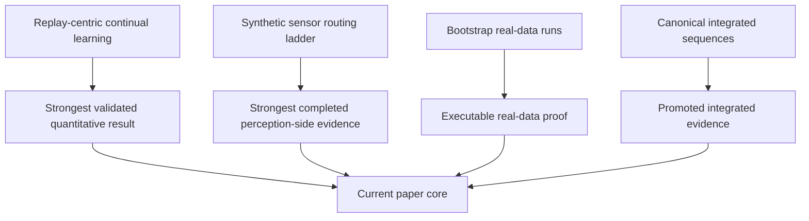

# Paper

This overview tracks the authoritative paper corpus under [paper/sections](/Users/zachshallbetter/Projects/Perception/paper/sections) and the generated results package under [paper/figures/generated/results_package](/Users/zachshallbetter/Projects/Perception/paper/figures/generated/results_package).

## Canonical Authority Model

Authoritative claim files:
- [00-implementation-status-matrix.md](/Users/zachshallbetter/Projects/Perception/paper/sections/00-implementation-status-matrix.md)
- [01-abstract.md](/Users/zachshallbetter/Projects/Perception/paper/sections/01-abstract.md)
- [02-introduction.md](/Users/zachshallbetter/Projects/Perception/paper/sections/02-introduction.md)
- [03-related-work.md](/Users/zachshallbetter/Projects/Perception/paper/sections/03-related-work.md)
- [04-methods.md](/Users/zachshallbetter/Projects/Perception/paper/sections/04-methods.md)
- [05-experiments.md](/Users/zachshallbetter/Projects/Perception/paper/sections/05-experiments.md)
- [06-results.md](/Users/zachshallbetter/Projects/Perception/paper/sections/06-results.md)
- [07-discussion.md](/Users/zachshallbetter/Projects/Perception/paper/sections/07-discussion.md)
- [08-conclusion.md](/Users/zachshallbetter/Projects/Perception/paper/sections/08-conclusion.md)
- [10-concept-implementation-audit.md](/Users/zachshallbetter/Projects/Perception/paper/sections/10-concept-implementation-audit.md)

`paper/sections/09-examples.md` is illustrative and non-empirical.

## Scope Baseline

- Empirical benchmark claims are bounded to currently reported results and active code paths.
- MIME semantics are framed as runtime-contract validation and modality setup derivation.
- Model forward dispatch is framed as modality-key based.
- Parameter isolation is framed as implemented model capability with opt-in service-path integration.
- The current paper-primary quantitative evidence is the 6-seed tuned-core Split-CIFAR-100 result.
- The current perception-side evidence path is the completed synthetic `sensor_streaming` canonical-vs-merged ladder plus bounded real-data follow-on sequences.

## Authority Labels

- **Implemented**: present in the current code path
- **Evidenced**: backed by packaged results or completed reports
- **Conceptual**: design idea or architecture pattern not yet promoted into the canonical paper
- **Patent candidate**: novelty-oriented idea tracked separately under [paper/patents](/Users/zachshallbetter/Projects/Perception/paper/patents)
- **Blocked / open problem**: not runnable or not defined enough

Conceptual architecture extensions and domain examples now live under [reference/future-concepts/README.md](/Users/zachshallbetter/Projects/Perception/reference/future-concepts/README.md). They are useful for future implementation and IP work, but they are not current paper evidence unless promoted by the implementation and results gates.

## Promotion Workflow

New Titan evidence does not change the paper automatically.

Promotion into the canonical paper requires:

1. a bounded sequence report with status `completed`
2. no blocked entries in that report
3. all expected result artifacts present
4. a successful rebuild of the canonical package under [paper/figures/generated/results_package](/Users/zachshallbetter/Projects/Perception/paper/figures/generated/results_package)

If a sequence blocks or fails, it should update:

- sequence summaries
- package status files
- future-use concept or patent notes if helpful

It should **not** update the canonical Results or Discussion sections until the package gate clears.

## Reader Map

If you want to understand the paper quickly, read:

1. [01-abstract.md](/Users/zachshallbetter/Projects/Perception/paper/sections/01-abstract.md)
2. [02-introduction.md](/Users/zachshallbetter/Projects/Perception/paper/sections/02-introduction.md)
3. [06-results.md](/Users/zachshallbetter/Projects/Perception/paper/sections/06-results.md)
4. [07-discussion.md](/Users/zachshallbetter/Projects/Perception/paper/sections/07-discussion.md)

If you want to understand what a user or product team can actually do with the results, pair the paper with:

- [README.md](/Users/zachshallbetter/Projects/Perception/README.md)
- [productization-roadmap.md](/Users/zachshallbetter/Projects/Perception/docs/productization-roadmap.md)

## Story Map

This is important because the current strongest evidence remains replay-centric continual learning, while the broader perception-side sensor/MIME claim is now supported by a completed synthetic routing ladder plus completed promotable integrated audio and sensor sequences.

## Practical Reader Takeaway

The practical takeaway should be read at two levels:

1. **What the project currently proves**
   - replay placement matters for continual retention
   - typed routing has meaningful synthetic perception-side support
   - real wearable and audio evidence now exists as bounded, completed integrated benchmark paths

2. **What a future user would actually get if the architecture continues to validate**
   - a perception system that can combine multiple sensory channels,
   - stay coherent when one modality is noisy or missing,
   - and keep adapting to new environments or users without full retraining.

That is the right user-facing interpretation of the paper. The current value lies in the architecture and update discipline, not in claiming a finished universal perception product.

## What Currently Counts As Evidence

Current strong evidence:

- Phase 1 vs Phase 2 replay-path progression on Split-CIFAR-100
- tuned-core 6-seed Titan result
- negative evidence from the BWT follow-on sweep

Current completed perception-side evidence:

- `sensor_streaming` canonical-vs-merged routing
- leave-one-out, corruption, and noise stress tests
- capacity-matched routing control

Current promotable integrated evidence:

- `real-audio-seq-003` completed cleanly and is now the promotable canonical integrated audio sequence
- `real-sensor-seq-002` completed cleanly and is now the promotable canonical integrated sensor sequence

## Monolith Policy

`paper/Perception Is How We Experience.md` is a generated monolith assembled from canonical section files.
Do not hand-edit the monolith as a source of truth.

## Current Paper Package

The paper-ready tables, plots, captions, and provenance manifest are generated under:

- `paper/figures/generated/results_package/`

These assets are the canonical figure/table bundle for the current results section and should stay synchronized with `paper/sections/06-results.md`.

## Supplementary Tracks

- Research drafts: `paper/supplementary/research-papers/`
- Patent drafts: `paper/patents/`

These tracks are non-canonical and must stay synchronized with implementation status constraints in `paper/sections/10-concept-implementation-audit.md`.
