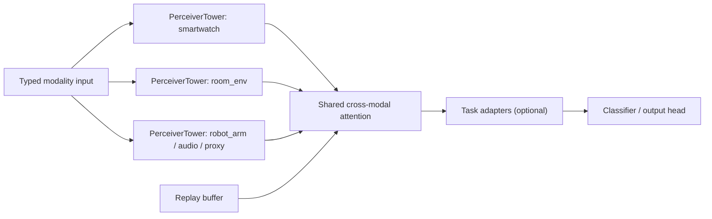

# Methods (Code-Aligned)

## 4.1 System Architecture

The implemented architecture consists of:

1. **Modality-specific PerceiverTowers** for local feature extraction.
2. **Shared cross-modal attention** over concatenated modality embeddings.
3. **Optional task adapters** for parameter isolation primitives.
4. **Replay buffer** with reservoir updates for continual learning.

Core model implementation: `src/models/core.py`.

Source files:
- [core.py](/Users/zachshallbetter/Projects/Perception/src/models/core.py)
- [mime_cases.py](/Users/zachshallbetter/Projects/Perception/src/runtime/mime_cases.py)
- [contracts.py](/Users/zachshallbetter/Projects/Perception/src/runtime/contracts.py)
- [training_service.py](/Users/zachshallbetter/Projects/Perception/src/services/training_service.py)

## 4.2 MIME-Style Input Cases and Routing Semantics

The runtime formalizes `sensor_streaming` modality cases as a canonical registry:

- `smartwatch` → `application/vnd.sensory.smartwatch.timeseries+tensor` (7 features)
- `room_env` → `application/vnd.sensory.environment.timeseries+tensor` (4 features)
- `robot_arm` → `application/vnd.sensory.robot-arm.timeseries+tensor` (9 features)

Registry implementation: `src/runtime/mime_cases.py`.

Important implementation detail: MIME semantics are enforced at runtime-contract boundaries for modality validation and setup derivation, while the model forward path dispatches by **modality keys** in the input dictionary.

## 4.3 Continual Learning Replay

### 4.3.1 Reservoir Sampling Buffer Management

For each sample index \(t\) with buffer capacity \(B\):
- if buffer not full, append;
- else replace a random slot with probability \(B/(t+1)\).

This ensures each observed sample has equal retention probability over time.

### 4.3.2 Replay Modes

The training service exposes three replay modes:

- `er`: cross-entropy on replayed raw samples.
- `contrastive`: NT-Xent-style feature alignment between current and replayed features.
- `feature`: classifier-level replay from a feature store (ablation baseline).

Replay is computed from raw modality inputs, so gradients can traverse the backbone when replayed batches are processed.

## 4.4 Parameter Isolation: Implemented API vs Active Pipeline

Implemented model capabilities:
- `TaskAdapter.freeze()`
- `SensoryPerceiver.freeze_task()` (freeze current adapter + allocate next)
- `get_trainable_parameters()`, `get_task_coverage()`

Current status:
- APIs are implemented and test-validated.
- Sequential activation is available in the service path via `adapter_rollover` with configurable `continual_task_count`.

## 4.5 Runtime and Services

The codebase uses a service-oriented runtime:

- `training_service.py`
- `evaluation_service.py`
- `orchestration_service.py`

with:
- typed runtime contracts (`TrainRuntimeConfig`, `EvalRuntimeConfig`, `OrchestratorRuntimeConfig`),
- typed error codes (`AppError`, `ErrorCode`),
- schema validation for persisted training config,
- structured JSON events + metrics snapshots.

## 4.6 Datasets in Current Implementation

Implemented in dataloader factory:
- `continual` (Split-CIFAR / Permuted-MNIST)
- `sensor_streaming` (generated multistream sensor dataset)
- `multimodal` (audio-visual proxy dataset)

Real benchmark ingestion is now bounded explicitly. Bootstrap real-data paths exist for WISDM and Speech Commands, while integrated canonical sequences remain pending. The active bounded lineups now extend beyond those bootstrap runs to include HF-backed replacements `fsd50k` and `realworld_har`, while the older `audioset` and `ubiqlog` options remain deferred outside the active chain.

External benchmark sources are tracked in [real-sensor-datasets.md](/Users/zachshallbetter/Projects/Perception/docs/real-sensor-datasets.md), including:
- [WISDM](https://archive.ics.uci.edu/dataset/507/wisdm%2Bsmartphone%2Band%2Bsmartwatch%2Bactivity%2Band%2Bbiometrics%2Bdataset)
- [Speech Commands](https://huggingface.co/datasets/google/speech_commands)
- [FSD50K](https://zenodo.org/records/4060432)
- [RealWorld HAR via sha-ce/SensorData](https://huggingface.co/datasets/sha-ce/SensorData)
