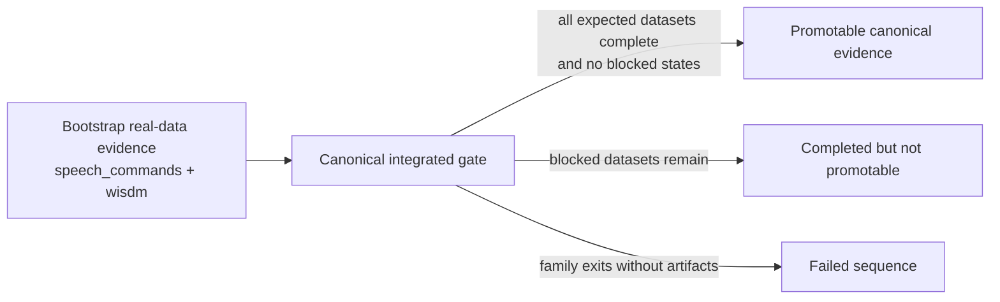

# Discussion

## 7.1 Core Mechanistic Insight

The current evidence supports a practical mechanism-level conclusion:

- Feature-only replay under-constrains shared representation layers.
- Raw-input replay forces replay gradients through the full feature stack.
- Reservoir sampling improves long-horizon sample retention fairness.
- The tuned-core continual path strengthens this result further without changing the core replay-centric story.

This explains the observed transition from near-total forgetting (Phase 1) to materially reduced forgetting (Phase 2) and then to the stronger tuned-core result.

## 7.2 What Is Implemented vs What Is Not

Implemented now:
- replay buffer with reservoir updates,
- replay mode control (`er`, `contrastive`),
- typed runtime/service orchestration,
- canonical `sensor_streaming` MIME case registry and validation.

Integrated but not yet empirically dominant:
- parameter-isolation primitives (task adapters with freeze/rollover APIs) exist in model code and tests, and sequential rollover is available in the service path, but these paths are not yet the strongest evidence-bearing benchmark result.

Planned:
- combined replay + full sequential adapter isolation benchmarks in the standard service path,
- real multimodal ingestion benchmarks at scale.

## 7.3 Naming and Protocol Semantics

The codebase now standardizes on `sensor_streaming` as canonical experiment/dataset identity. This reduces ambiguity and aligns runtime contracts, scripts, and documentation with a single term.

MIME semantics are formalized as a registry with explicit modality definitions and feature dimensions. At present this is used for contract-level validation and modality setup derivation; model forward dispatch remains modality-key based.

## 7.4 Research Consequences

1. **Replay quality and gradient path design matter as much as replay existence.**
2. **Protocolized modality definitions reduce hidden interface drift.**
3. **Parameter isolation is promising but should be presented as exploratory until it clearly outperforms the tuned replay-centric baseline.**

## 7.5 What The New Titan Results Add

The newer Titan runs sharpen the paper in two ways:

1. They provide a stronger paper-primary continual baseline than the earlier raw-input replay phase result alone.
2. They provide negative evidence that moderate EWC/SI increases and larger replay buffers do not automatically improve BWT.

This second point is important. The paper should not imply that adding regularization or mild structural isolation necessarily solves forgetting in this architecture. The current evidence says the opposite: replay-path design is the validated lever, while follow-on anti-forgetting knobs remain mixed.

## 7.6 What The Active Sensor Ladder Adds

The next decisive question is no longer "can we tweak BWT a little more with nearby regularizers?" It is:

- does typed sensor routing beat a merged generic stream?
- if so, does that advantage survive leave-one-out, binding-corruption, and noise stress tests?

This matters because it is the shortest path from architectural argument to measured perception-side evidence. The bounded Titan-local supervisor is useful here not as an optimization oracle, but as a way to execute that evidence ladder in a fixed, interpretable order with explicit stop states.

The same discipline now applies to the real-data path. The repository now distinguishes **bootstrap** real-data evidence from the **canonical integrated** sequences that will carry the next paper-facing quantitative claim. WISDM and Speech Commands established the first executable sensor and audio paths, but the bounded integrated sequences (`real-audio-seq-002` and `real-sensor-seq-001`) are the ones promoted as the current canonical evidence package once they complete. Crucially, the real-data supervisors do not erase implementation boundaries: datasets without prepared canonical splits remain blocked, and broader sensor/body or audio candidates are tracked as queued rather than reported as if they were already empirical support. This keeps the paper aligned with actual executable evidence instead of with aspirational coverage.

The completed ladder now gives a meaningful answer. Canonical typed routing is ahead on:

- the baseline comparison,
- the capacity-matched control,
- all completed leave-one-out branches,
- the binding-corruption branch,
- two of the three single-modality noise branches.

The pattern is not uniform in magnitude. The strongest support appears in the baseline, capacity-matched, and leave-one-out branches. The weakest support appears under single-modality noise, where the merged route recovers much of the gap. In `noise_robot_arm`, merged routing actually wins. That is exactly the kind of nuance we want: it suggests typed routing is helpful, but not magically robust to every stressor.

The right current discussion stance is therefore:

1. typed routing now has stronger direct evidence than it did before this ladder,
2. capacity confounding is no longer the leading explanation for the baseline gap,
3. the claim should still be framed as controlled synthetic support until real-domain benchmarks exist.

The current real-data gate reinforces the same discipline. `real-audio-seq-002` should not be promoted simply because the sequence report says `completed`; it completed with blocked datasets still present. `real-sensor-seq-001` should not be described as merely pending; its current report is a failed sequence at `pamap2`. Those distinctions are exactly why the bootstrap-versus-canonical taxonomy exists.

## 7.7 Next Experimental Priorities

1. Turn the completed sensor ladder into a paper-ready figure/table package alongside the continual-learning package.
2. Add confidence intervals and fuller statistical treatment to the tuned-core continual benchmark.
3. Benchmark sequential adapter rollover against the tuned-core result, not just against older phase baselines.
4. Replace or augment synthetic `sensor_streaming` evidence with at least one real-domain sensor benchmark.
5. Add real multimodal ingestion/evaluation paths and report them separately from proxy datasets.

## 7.8 Practical Implications

If the present claims continue to hold, the practical lesson is not that Sensory Perceiver is already a universal product-ready perception model. The practical lesson is narrower and more useful:

1. **Keep modality identity explicit.**
   - Systems that ingest heterogeneous sensory streams should preserve modality structure instead of flattening all inputs into one undifferentiated channel at the boundary.

2. **Use canonical modality contracts.**
   - MIME-style modality registries and validated runtime bindings reduce hidden interface drift and make sensor extension safer.

3. **Make continual-learning safeguards act on the shared backbone.**
   - If a deployed system must adapt over time, replay should reach the shared perceptual feature stack rather than only late task heads.

4. **Treat perception and adaptation as one systems problem.**
   - The architectural and continual-learning results are most useful together: explicit sensor structure helps define the model, while replay-centric retention determines whether that structure survives incremental updates.

For applied users, this means the repository is best understood as a design reference for domain-specific perception systems in robotics, wearables, ambient sensing, or monitoring applications. The current value lies in the architecture and update discipline, not in claiming a fully general perception product.

## 7.9 What A User Actually Gets

If the broader concept continues to validate, the user-facing result is not "MIME semantics" or "a better benchmark score." The user-facing result is a perception system that can:

- combine multiple sensory channels instead of depending on one brittle input,
- preserve modality structure instead of flattening all evidence into a generic stream at the boundary,
- keep operating when one modality is noisy, missing, or partially corrupted,
- and continue adapting to new users, rooms, devices, or tasks without full retraining.

That matters because most practical perception systems fail in one of three ways:

1. they depend too heavily on one modality,
2. they lose important structure by collapsing heterogeneous streams too early,
3. they forget prior competence when updated.

The design principles supported by this repository point toward a different user outcome:

- more reliable room or activity awareness from multiple signals,
- better assistive or monitoring systems that tolerate degraded sensors,
- more natural multimodal interfaces,
- and more adaptive embodied or ambient systems that improve without repeatedly starting over.

The present implementation still has to earn that result across more real datasets before the broadest claims are fully justified. But this is the correct user-level interpretation of the work: a structured, adaptive perception engine, not just a narrower benchmark win.
